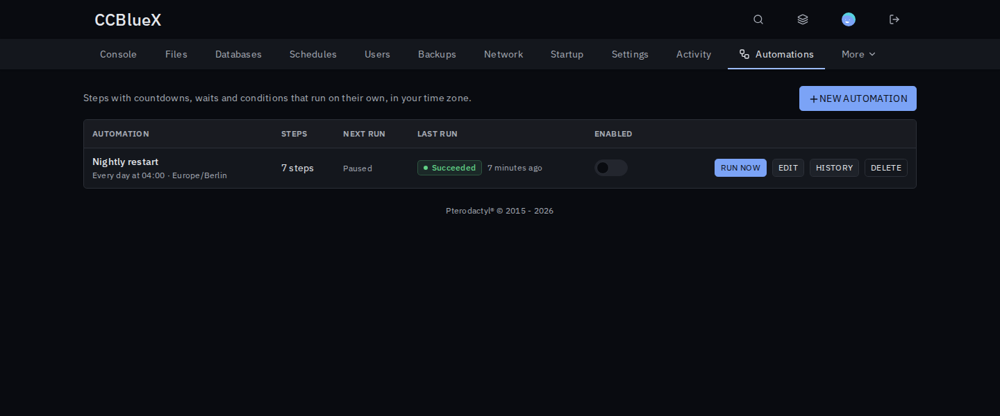
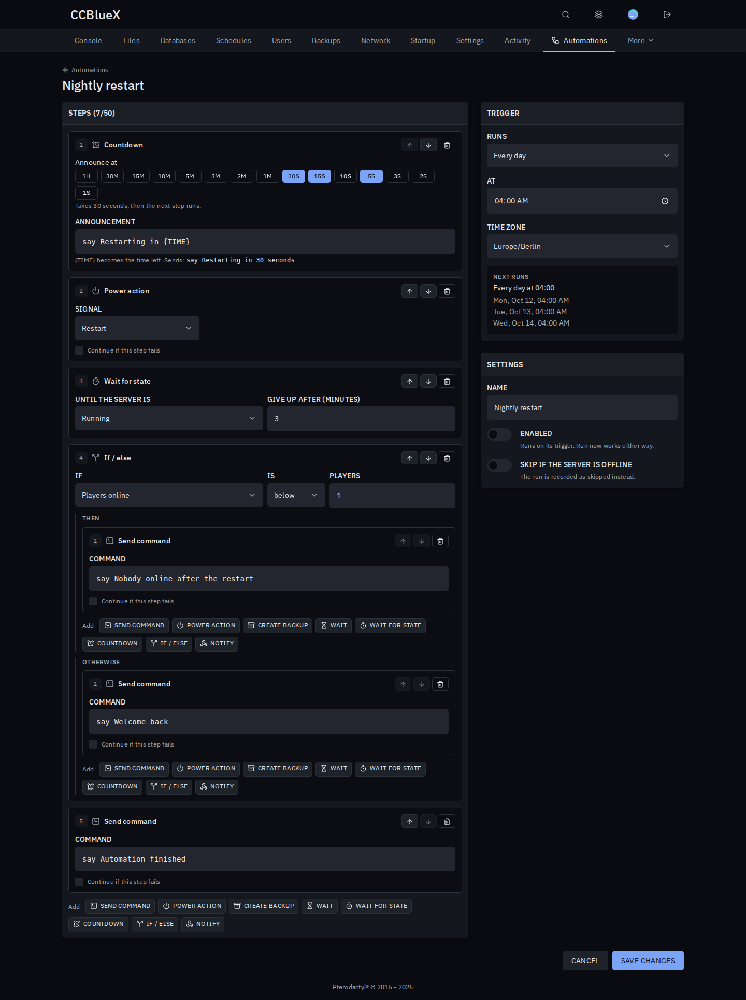
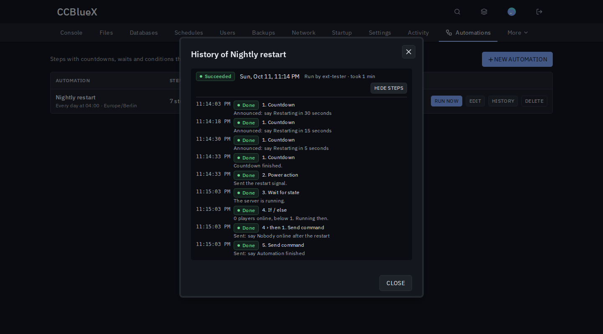

# Automations for Pterodactyl

Schedules that do more: restart with a countdown, only when nobody is online, then tell Discord the server is back.

## Install

1. Download `automations-<version>.pteroext` from the [latest release](https://github.com/CCBlueX/Pterodactyl-Extension-Automations/releases/latest).
2. Install and enable it under **Admin → Extensions**.
3. Open a server's **Automations** tab and click **New automation**.

## Features

- **Steps**: console commands, power actions, backups, waits, "wait until running or offline", countdowns and Discord or webhook messages.
- **Conditions**: if/else on the server state, CPU or memory usage, or the number of players online (Minecraft).
- **Triggers in your time zone**: every few minutes, daily or on chosen weekdays, with a preview of the next runs.
- **Live progress and history**: see which step is running, cancel a run, and read a log of every step.
- **Safe**: steps need the same permissions as doing it by hand, and webhooks cannot reach private networks.

## Settings

| Setting | Default | What it does |
| --- | --- | --- |
| Allow private webhook targets | Off | Lets notify steps post to private networks. |
| Player count host | Empty | Host used to reach Minecraft servers for player conditions, when the allocation address does not work from the panel. |

Subusers get an **Automations** group in the server's **Users** tab: see, manage and run automations.

---

Inspired by SchedulesPlus. The core **Schedules** page stays as it is and links here.
